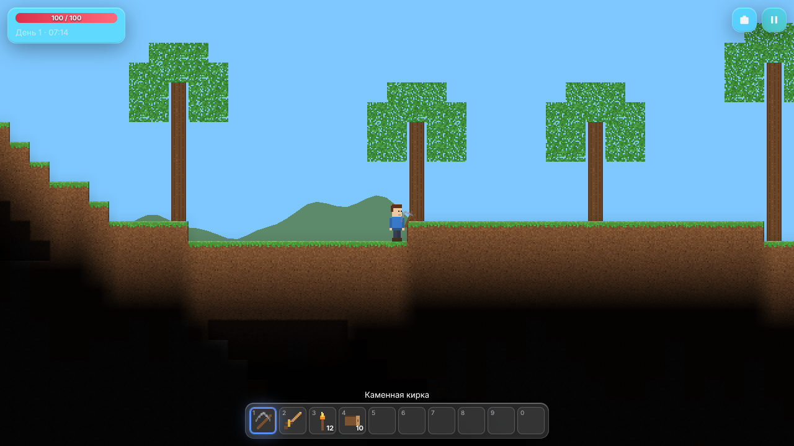
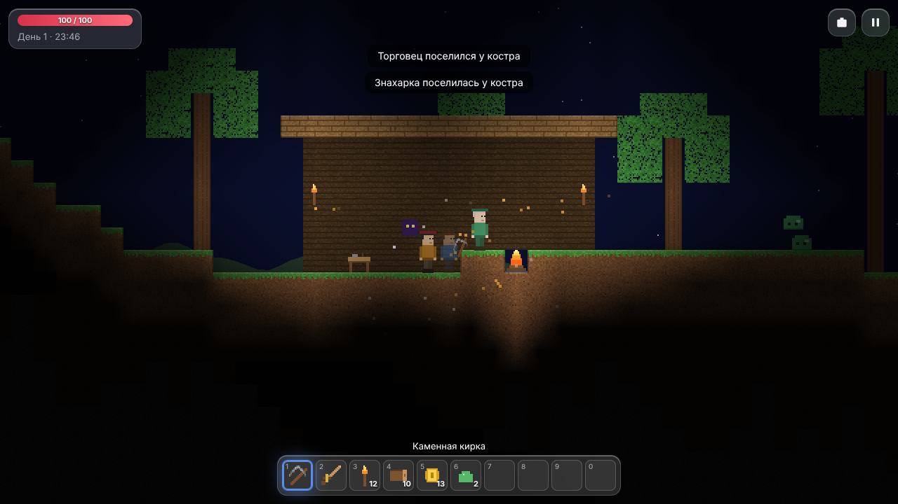
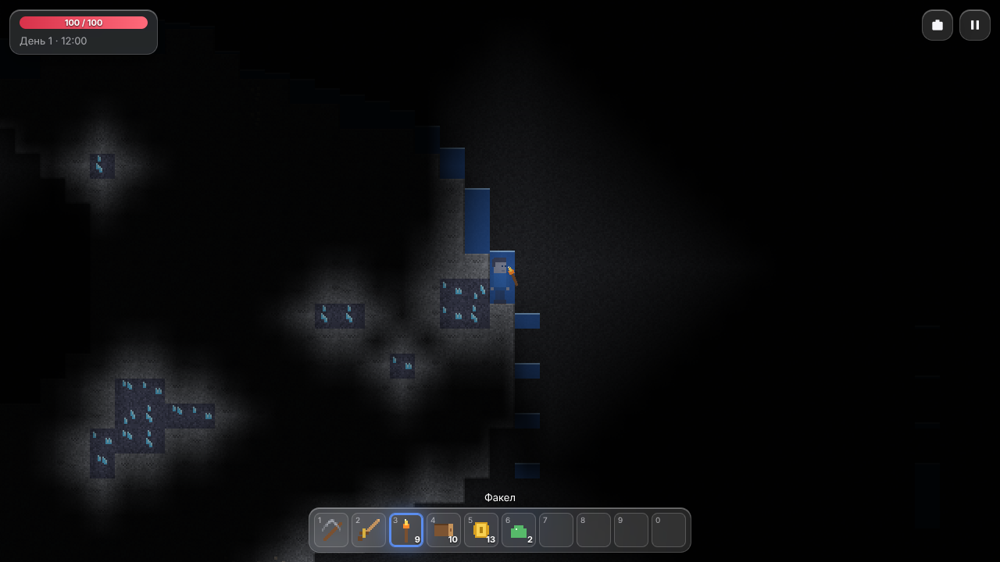
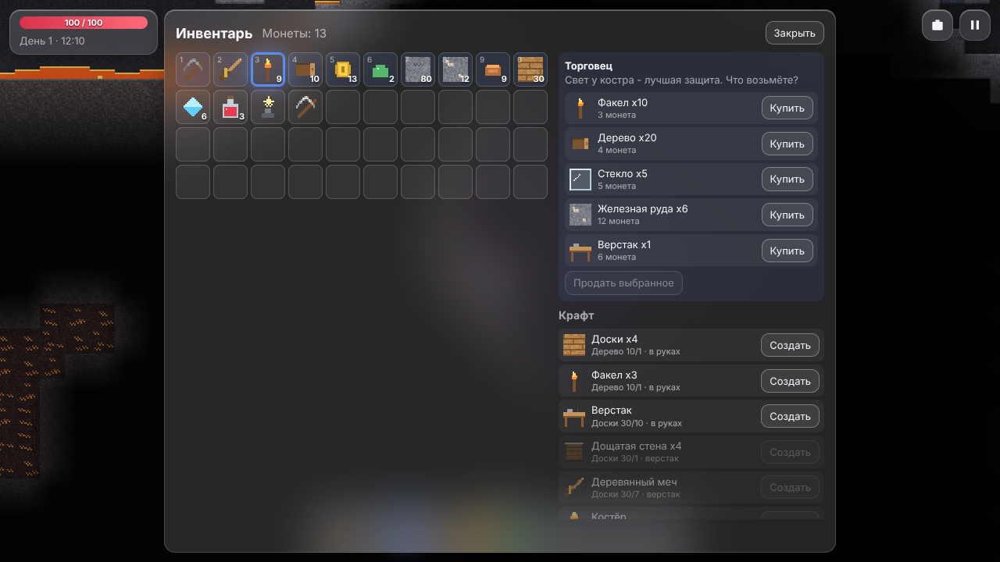
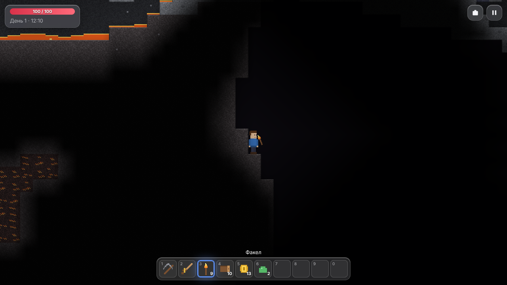
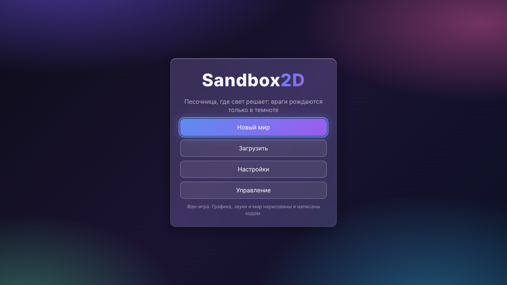
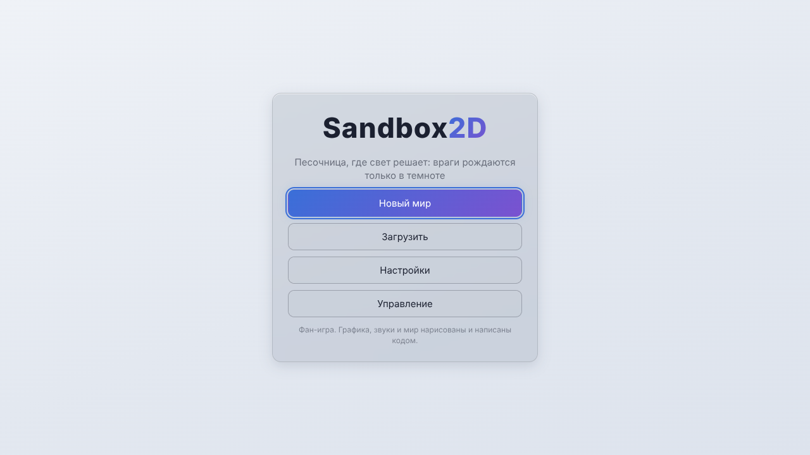
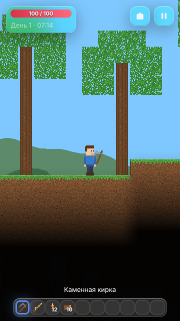

# Sandbox2D

**English** · [Русский](README.ru.md)

[](#) [](https://github.com/ALEXalesha/Sandbox2D/actions/workflows/ci.yml) [](LICENSE) [](https://developer.mozilla.org/docs/Web/JavaScript) [](https://pixijs.com/) [](https://www.electronjs.org/) [](https://alexalesha.github.io/Sandbox2D/) [](https://claude.com/claude-code)

Code, tests and docs are written by Claude (Anthropic) in Claude Code. Ideas, testing and decisions - Alexey.

A 2D block sandbox for the browser where **light rules**: monsters are born only in dark cells
and burn in bright light, a torch makes a safe zone, and residents come only to a lit campfire.
Dig and build, place walls behind blocks, watch water and lava flow (and turn into obsidian
when they meet), craft at a workbench, a furnace and an anvil, survive the night, call two
bosses and trade with residents. The world is generated from a seed in chunks: hills, caves,
ores by depth, forest, desert and snow, and an underworld at the bottom.

**A fan game** in the 2D sandbox genre. All graphics, sounds and names are its own and made in
code; there are no sprites, sounds or marks of other games.



| Night by the campfire | Cave with water and crystals |
|---|---|
|  |  |
| **Inventory, crafting and the shop** | **Underworld** |
|  |  |

Menu in the Glass and Light themes (five themes as in Paint Pro: Glass, Formal, Light, Night,
Warm), and a narrow window:

| Glass | Light | Narrow window |
|---|---|---|
|  |  |  |

## Controls

| Action | Keys |
|---|---|
| Walk | A / D or ← / → |
| Jump, swim up | Space or W |
| Use the item in hand | left mouse button: a pickaxe digs (on an empty cell with a wall it removes the wall), a sword strikes, a block or a wall is placed, a potion is drunk, a summon item calls a boss |
| Talk to a resident | right mouse button on a resident, or F |
| Inventory and crafting | E or I |
| Hotbar slot | 1-0, mouse wheel |
| Zoom | = / - |
| Hints | M |
| Pause | Esc |

Every key except Esc and the digits can be rebound in Settings. The game never captures the
mouse pointer.

## How to play

- Wood from trees -> planks -> a workbench. Torches are crafted by hand from wood.
- Stone + wood + torches -> a furnace: bars from ore, glass from sand, bricks from stone.
- Iron bars -> an anvil: copper, iron, crystal and magmite pickaxes and swords.
- Copper is near the surface, iron deeper, crystals deep below (they glow), magmite only in
  the underworld. A weak pickaxe cannot mine strong ore.
- At night the surface is dark and monsters are born there. Place torches and campfires.
- A campfire calls the trader (once you have 10 coins) and then the healer (after 10 victories).
- The star beacon (at night) calls the Night Colossus; the obsidian key (in the underworld)
  calls the Magma Heart. Both drop a life shard (+20 max health).

## Run

In the browser: open `web/index.html` (no build and no server needed) or the
[website](https://alexalesha.github.io/Sandbox2D/).

As a desktop app (Electron), and the checks:

```bash
npm ci
```

```bash
npm start
```

```bash
npm run cover
```

```bash
npm run test:web
```

```bash
npm run test:app
```

```bash
npm run mutate
```

`npm run cover` runs the game laws (node:test) with branch coverage: core (`web/js/core`) at
least 90 %, all code without windows (`core` + `sys`) at least 80 %. `npm run mutate` breaks
each rule in a copy of `web/` and checks that its law notices. `npm run dist` builds the Windows
installer and portable exe.

## Layout

- `web/js/core/` - the pure rules without a screen: noise, blocks, generation, chunked world,
  light, liquids, physics, inventory and crafting, save, day and night, monsters and bosses,
  residents, the game step. The same files run in the browser and in node.
- `web/js/sys/` - keys and rebinding, settings and world slots, ru/en translation.
- `web/js/ui/` - PixiJS rendering, textures and sounds made in code, menus and the main loop.
- `electron/` - the desktop window, as in RailRunner.
- `docs/superpowers/` - the design and the plan of stages.

## License

MIT, see [LICENSE](LICENSE). PixiJS is MIT (`web/vendor/PIXI-LICENSE.txt`).
