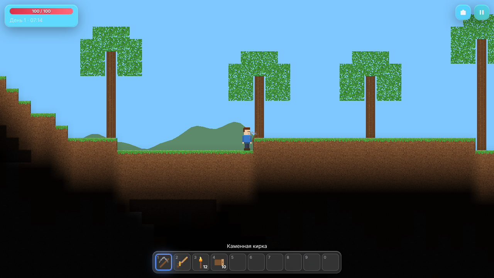
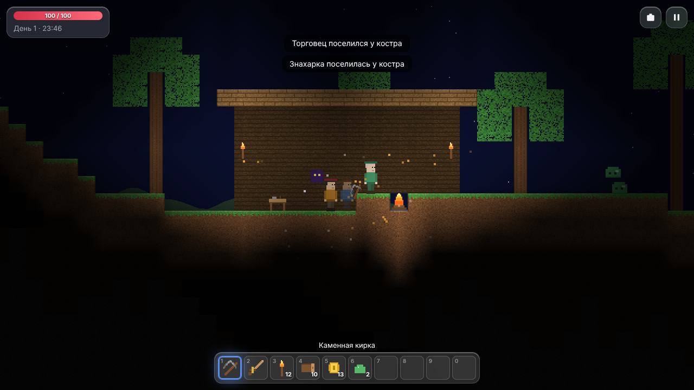
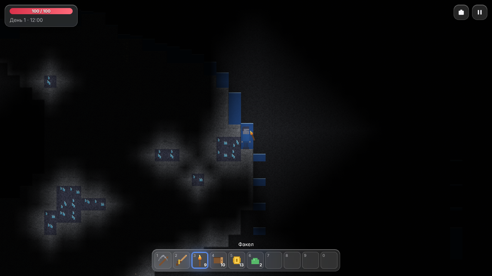
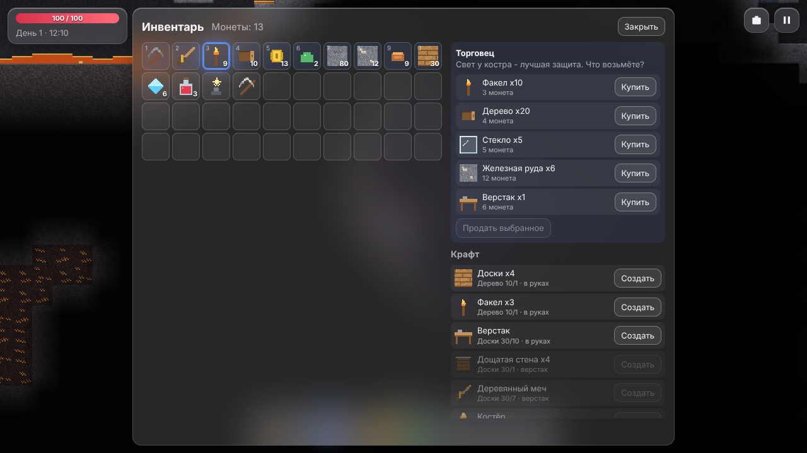
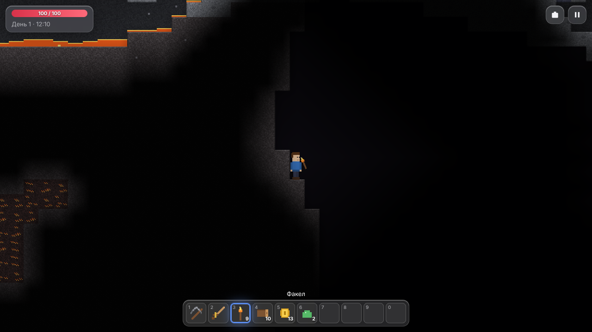
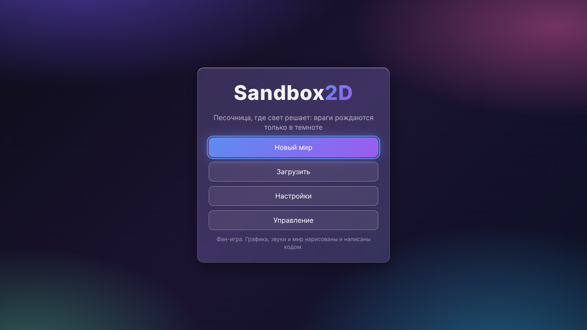
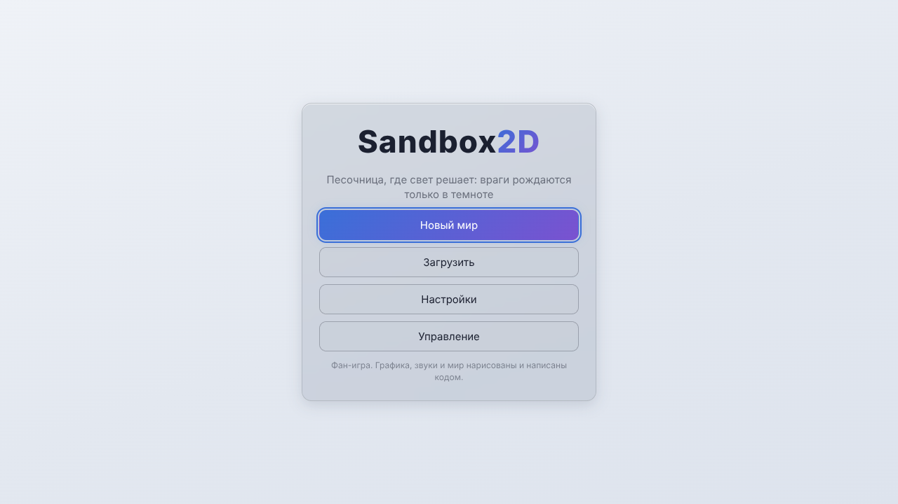
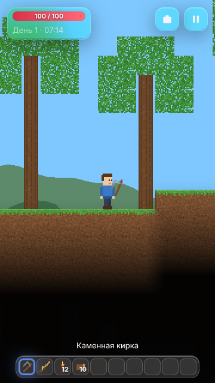

# Sandbox2D

[English](README.md) · **Русский**

[](#) [](https://github.com/ALEXalesha/Sandbox2D/actions/workflows/ci.yml) [](LICENSE) [](https://developer.mozilla.org/docs/Web/JavaScript) [](https://pixijs.com/) [](https://www.electronjs.org/) [](https://alexalesha.github.io/Sandbox2D/) [](https://claude.com/claude-code)

Код, тесты и документацию написал Claude (Anthropic) в Claude Code; идеи, проверка и решения - Алексея.

Двумерная песочница из блоков для браузера, где **свет решает**: враги рождаются только в
тёмных клетках и горят в ярком свете, факел делает вокруг себя безопасную зону, а жители
приходят только к освещённому костру. Копайте и стройте, ставьте стены за блоками, смотрите,
как течёт вода и лава (а при встрече становится обсидианом), создавайте вещи на верстаке, в печи
и на наковальне, переживите ночь, позовите двух боссов и торгуйте с жителями. Мир строится по
зерну чанками: холмы, пещеры, руды по глубине, лес, пустыня и снега, внизу - подземный ад.

**Фан-игра** в жанре 2D-песочницы. Вся графика, звуки и имена свои и сделаны кодом; спрайтов,
звуков и марок других игр нет.



| Ночь у костра | Пещера с водой и кристаллами |
|---|---|
|  |  |
| **Инвентарь, крафт и лавка** | **Подземный ад** |
|  |  |

Меню в темах «Стекло» и «Светлая» (пять тем как в Paint Pro: Стекло, Строгая, Светлая,
Ночная, Тёплая) и узкое окно:

| Стекло | Светлая | Узкое окно |
|---|---|---|
|  |  |  |

## Управление

| Действие | Клавиши |
|---|---|
| Идти | A / D или ← / → |
| Прыжок, плыть вверх | Пробел или W |
| Использовать предмет в руке | левая кнопка мыши: кирка копает (по пустой клетке со стеной - снимает стену), меч бьёт, блок или стена ставится, зелье выпивается, предмет вызова зовёт босса |
| Говорить с жителем | правая кнопка мыши по жителю или F |
| Инвентарь и крафт | E или I |
| Ячейка панели | 1-0, колесо мыши |
| Масштаб | = / - |
| Подсказки | M |
| Пауза | Esc |

Все клавиши, кроме Esc и цифр, переназначаются в настройках. Игра никогда не захватывает
указатель мыши.

## Как играть

- Дерево с деревьев -> доски -> верстак. Факелы делаются из дерева прямо в руках.
- Камень + дерево + факелы -> печь: слитки из руды, стекло из песка, кирпич из камня.
- Железные слитки -> наковальня: медные, железные, кристальные и магмитовые кирки и мечи.
- Медь у поверхности, железо глубже, кристаллы глубоко (светятся), магмит только в аду.
  Слабая кирка крепкую руду не берёт.
- Ночью на поверхности темно, и там рождаются враги. Ставьте факелы и костры.
- Костёр зовёт торговца (когда у вас 10 монет), а потом знахарку (после 10 побед).
- Звёздный маяк (ночью) зовёт Ночного колосса, обсидиановый ключ (в аду) - Сердце магмы.
  Оба оставляют осколок жизни (+20 к здоровью).

## Как запустить

В браузере: открыть `web/index.html` (ни сборки, ни сервера не нужно) или
[сайт](https://alexalesha.github.io/Sandbox2D/).

Приложением на компьютере (Electron) и проверки:

```bash
npm ci
```

```bash
npm start
```

```bash
npm run cover
```

```bash
npm run test:web
```

```bash
npm run test:app
```

```bash
npm run mutate
```

`npm run cover` - законы игры (node:test) с покрытием по ветвям: ядро (`web/js/core`) не меньше
90 %, весь код без окон (`core` + `sys`) не меньше 80 %. `npm run mutate` по очереди ломает
каждое правило в копии `web/` и проверяет, что его закон это замечает. `npm run dist` собирает
установщик и переносной exe для Windows.

## Устройство

- `web/js/core/` - чистые правила без экрана: шум, блоки, генерация, мир чанками, свет,
  жидкости, физика, инвентарь и крафт, сохранение, день и ночь, враги и боссы, жители, шаг игры.
  Одни и те же файлы работают в браузере и в node.
- `web/js/sys/` - клавиши и переназначение, настройки и ячейки миров, перевод ru/en.
- `web/js/ui/` - отрисовка на PixiJS, текстуры и звуки кодом, меню и главный цикл.
- `electron/` - окно приложения, как у RailRunner.
- `docs/superpowers/` - замысел и план этапов.

## Лицензия

MIT, см. [LICENSE](LICENSE). PixiJS - MIT (`web/vendor/PIXI-LICENSE.txt`).
